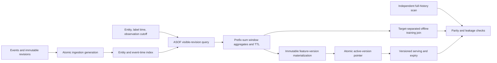

# Feature query and serving flow

`feature_store.py` owns validated events, specifications, point-in-time SQL, offline joins and atomic online versions. `oracle.py` independently resolves visible revisions by full scan and aggregates each window separately. `experiments.py` generates late observations, corrections, tombstones and backfills, then checks feature/serving parity.

The ingestion boundary changes source generation atomically. Offline joins pin a generation and read snapshot. Materialization publishes entity rows and the active pointer together. The target is never passed to the query function. SQL values are bound parameters, not interpolated expressions.
